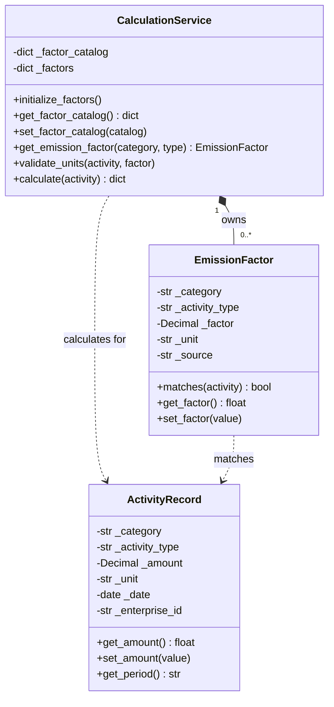

## Running the Project with Docker Compose

This project supports Docker Compose to simplify the setup and execution of the Enterprise Carbon Tracker application.

Docker Compose automatically builds and runs three services:

- **Frontend:** React + Vite
- **Backend:** Python + FastAPI
- **Database:** MongoDB 8.0

### Prerequisites

Install [Docker Desktop](https://www.docker.com/products/docker-desktop/) and ensure Docker Engine is running.

You do not need to install MongoDB, Python, or Node.js separately when using Docker.

### Step 1: Clone the repository

```bash
git clone https://github.com/oscar-byte15/Enterprise-carbon-tracker.git
cd Enterprise-carbon-tracker
```

### Step 2: Configure environment variables

Create a `.env` file in the project root using `.env.example` as a reference.

Configure any required local development secrets or API keys. Never commit real credentials to GitHub.

### Step 3: Start the application

From the project root, run:

```bash
docker compose up --build -d
```

Docker Compose will build and start the frontend, backend, and MongoDB services.

### Step 4: Access the application

| Service | URL |
|---|---|
| Frontend | http://localhost:5173 |
| FastAPI Swagger UI | http://localhost:8000/docs |
| MongoDB Compass | mongodb://127.0.0.1:27018 |

### Useful commands

```bash
# Start containers
docker compose up -d

# Check container status
docker compose ps

# View backend logs
docker compose logs -f backend

# Rebuild after code changes
docker compose up --build -d

# Stop containers
docker compose down
```

### Database persistence

MongoDB uses a Docker volume to persist application data between normal container restarts.

Each developer runs an independent local MongoDB database. Docker Compose does not automatically synchronize data between team members.

**Important:** Avoid `docker compose down -v` unless you intentionally want to remove the Docker-managed database volume.

### Development notes

- FastAPI communicates with MongoDB through the Docker Compose service network.
- The frontend communicates with FastAPI through the exposed backend port.
- Code changes may require rebuilding Docker images.
- Authentication data is currently stored in memory until MongoDB persistence is implemented for Subsystem 1.
- For additional information, refer to `DOCKER-README.md`.

## Running Unit Tests with Docker

The project supports automated unit testing with **Pytest**.

Subsystem 2 (Carbon Activity Management & Calculation Engine) currently includes 22 unit tests covering emission calculations, input validation, CRUD operations, and enterprise-based data isolation.

### Run Unit Tests using Docker

From the project root directory, build the testing image:

```bash
docker build --target test -t carbon-tracker-tests ./backend
```

Then run the tests:

```bash
docker run --rm carbon-tracker-tests
```

Docker will execute the tests inside an isolated container using Pytest and MongoMock.

**Note:** MongoMock simulates the database, so these unit tests do not require a running MongoDB server or modify production data.

### Run Unit Tests locally

Alternatively, from the `backend` directory:

```bash
python -m pip install -r requirements-dev.txt
python -m pytest tests/ -v
```

### Verified Test Results

| Test Module | Passed | Failed |
|---|---:|---:|
| Calculation Engine | 14 | 0 |
| MongoDB Repository | 8 | 0 |
| **Total** | **22** | **0** |

Last verified: October 31, 2026.

These tests verify the configured emission calculations, repository CRUD operations, and enterprise data isolation at the repository level. They do not replace full API integration or end-to-end tests.

### Adding New Tests

When adding new test files or modifying existing tests, rebuild the test image:

```bash
docker build --target test -t carbon-tracker-tests ./backend
docker run --rm carbon-tracker-tests
```

This ensures Docker runs the latest tests.
---

## Hometask 1 — Object-Oriented Concepts

This assignment translates the team's Capstone subsystem architecture into Python OOP classes. **Submission branch:** `Homeassignment1`.

### Team Overview

| Team member | Assigned subsystem | Implementation |
|---|---|---|
| Oscar Daniel de la Cruz Jara | Subsystem 2 — Carbon Activity Management & Calculation Engine | [Three OOP classes, UML and unit tests](docs/Hometask1-Subsystem2.md) |
| Other team members | To be completed by the team | Add each member's subsystem and three classes before submission |

### System Design — UML Diagrams

The composition (◆) indicates CalculationService owns zero or more EmissionFactor objects; there is no aggregation between the three classes. ActivityRecord is supplied to a calculation, rather than owned. Full design details are available in [Hometask 1 — Subsystem 2](docs/Hometask1-Subsystem2.md).



**Team note:** Add UML diagrams for Subsystems 1, 3, and 4 when their owners finish implementing their three classes.

### Team Video Presentation (3–5 minutes)

**Video link:** Pending team recording — replace this placeholder with the direct YouTube, Loom or Google Drive link before submission.

All four team members should explain their own classes and how they correspond to their subsystem's UML architecture.

### Running Hometask 1 Tests

```bash
cd backend
python -m pip install -r requirements-dev.txt
python -m pytest tests/test_oop_hometask1.py -v
```

These new tests are in addition to the existing Subsystem 2 unit tests. Their execution is not yet verified in this branch.
