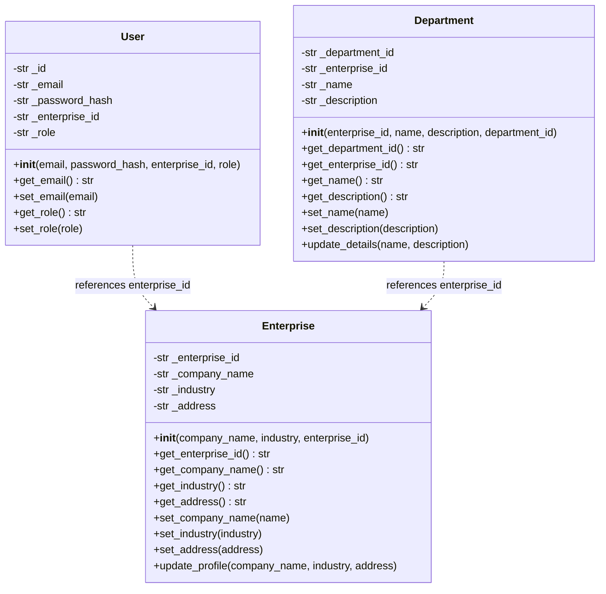
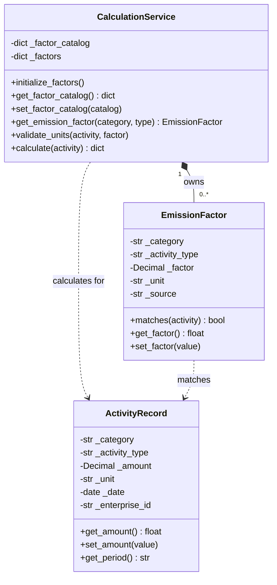
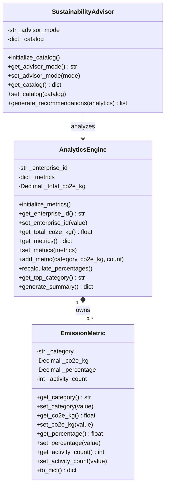
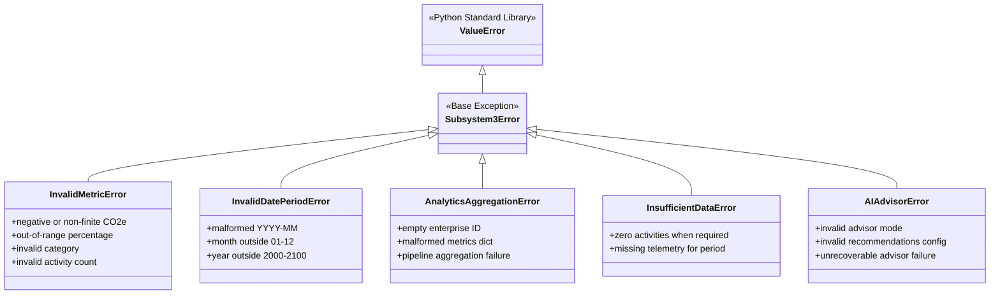

## Running the Project with Docker Compose

This project supports Docker Compose to simplify the setup and execution of the Enterprise Carbon Tracker application.

Docker Compose automatically builds and runs three services:

- **Frontend:** React + Vite
- **Backend:** Python + FastAPI
- **Database:** MongoDB 8.0

### Prerequisites

Install [Docker Desktop](https://www.docker.com/products/docker-desktop/) and ensure Docker Engine is running.

You do not need to install MongoDB, Python, or Node.js separately when using Docker.

### Step 1: Clone the repository

```bash
git clone https://github.com/oscar-byte15/Enterprise-carbon-tracker.git
cd Enterprise-carbon-tracker
```

### Step 2: Configure environment variables

Create a `.env` file in the project root using `.env.example` as a reference.

Configure any required local development secrets or API keys. Never commit real credentials to GitHub.

### Step 3: Start the application

From the project root, run:

```bash
docker compose up --build -d
```

Docker Compose will build and start the frontend, backend, and MongoDB services.

### Step 4: Access the application

| Service | URL |
|---|---|
| Frontend | http://localhost:5173 |
| FastAPI Swagger UI | http://localhost:8000/docs |
| MongoDB Compass | mongodb://127.0.0.1:27018 |

### Useful commands

```bash
# Start containers
docker compose up -d

# Check container status
docker compose ps

# View backend logs
docker compose logs -f backend

# Rebuild after code changes
docker compose up --build -d

# Stop containers
docker compose down
```

### Database persistence

MongoDB uses a Docker volume to persist application data between normal container restarts.

Each developer runs an independent local MongoDB database. Docker Compose does not automatically synchronize data between team members.

**Important:** Avoid `docker compose down -v` unless you intentionally want to remove the Docker-managed database volume.

### Development notes

- FastAPI communicates with MongoDB through the Docker Compose service network.
- The frontend communicates with FastAPI through the exposed backend port.
- Code changes may require rebuilding Docker images.
- Authentication and enterprise records are persisted in MongoDB through `backend/app/mongo_store.py`, which is instantiated by `backend/app/store.py` for the FastAPI routes.
- For additional information, refer to `DOCKER-README.md`.

## Running Unit Tests with Docker

The project supports automated unit testing with **Pytest**.

Subsystem 2 (Carbon Activity Management & Calculation Engine) currently includes 22 unit tests covering emission calculations, input validation, CRUD operations, and enterprise-based data isolation.

### Run Unit Tests using Docker

From the project root directory, build the testing image:

```bash
docker build --target test -t carbon-tracker-tests ./backend
```

Then run the tests:

```bash
docker run --rm carbon-tracker-tests
```

Docker will execute the tests inside an isolated container using Pytest and MongoMock.

**Note:** MongoMock simulates the database, so these unit tests do not require a running MongoDB server or modify production data.

### Run Unit Tests locally

Alternatively, from the `backend` directory:

```bash
python -m pip install -r requirements-dev.txt
python -m pytest tests/ -v
```

### Verified Test Results

| Test Module | Passed | Failed |
|---|---:|---:|
| Calculation Engine | 14 | 0 |
| MongoDB Repository | 8 | 0 |
| **Total** | **22** | **0** |

Last verified: October 31, 2026.

These tests verify the configured emission calculations, repository CRUD operations, and enterprise data isolation at the repository level. They do not replace full API integration or end-to-end tests.

### Adding New Tests

When adding new test files or modifying existing tests, rebuild the test image:

```bash
docker build --target test -t carbon-tracker-tests ./backend
docker run --rm carbon-tracker-tests
```

This ensures Docker runs the latest tests.
---

## Hometask 1 — Object-Oriented Concepts

This assignment translates the team's Capstone subsystem architecture into Python OOP classes. **Submission branch:** `Homeassignment1`.

### Team Overview

| Team member | Assigned subsystem | Implementation |
|---|---|---|
| Oscar Daniel de la Cruz Jara | Subsystem 2 — Carbon Activity Management & Calculation Engine | [Three OOP classes, UML and unit tests](docs/Hometask1-Subsystem2.md) |
| Usama Rasheed | Subsystem 3 — Analytics Dashboard & AI Advisory | [Three OOP classes (EmissionMetric, AnalyticsEngine, SustainabilityAdvisor), UML and unit tests](#subsystem-3--analytics-dashboard--ai-advisory-oop-implementation) |
| Other team members | Subsystems 1 & 4 | Add each member's subsystem and three classes before submission |

### System Design — UML Diagrams

#### Subsystem 1 - Authentication & Enterprise Management

The User and Department classes are logically associated with Enterprise through the `enterprise_id` attribute. These relationships represent references by identifier rather than direct object ownership. Therefore, no composition or aggregation is implemented between the three classes.



#### Subsystem 2 — Carbon Activity Management & Calculation Engine

The composition (◆) indicates CalculationService owns zero or more EmissionFactor objects; there is no aggregation between the three classes. ActivityRecord is supplied to a calculation, rather than owned. Full design details are available in [Hometask 1 — Subsystem 2](docs/Hometask1-Subsystem2.md).



#### Subsystem 3 — Analytics Dashboard & AI Advisory

The composition (◆) models AnalyticsEngine creating, managing, and owning multiple EmissionMetric instances. SustainabilityAdvisor exhibits a dependency (..>) on AnalyticsEngine, analyzing enterprise metrics without retaining ownership.



**Team note:** Add UML diagrams for Subsystems 1 and 4 when their owners finish implementing their three classes.

### Subsystem 1 — User Authentication & Enterprise Management (OOP Implementation)

The Subsystem 1 OOP implementation is located in `backend/app/oop_subsystem1.py`.

This subsystem focuses on user account information, enterprise profiles, and department management. Three OOP classes have been implemented to represent the core entities of Subsystem 1.

#### Three Implemented Classes

| Class | Responsibility | Constructor | Encapsulation / Methods |
|---|---|---|---|
| `User` | Represents a user account associated with an enterprise. Stores the user's email, hashed password, enterprise ID, and role. | `__init__(email, password_hash, enterprise_id, role="admin")` | Uses protected-style attributes (`_email`, `_role`, etc.) and getter/setter methods to access and update account information. |
| `Enterprise` | Represents an enterprise profile, including its company name, industry, and address. | `__init__(company_name, industry, enterprise_id=None)` | Provides getter/setter methods for enterprise information and `update_profile()` for updating multiple profile fields. |
| `Department` | Represents a department belonging to an enterprise, including its name and description. | `__init__(enterprise_id, name, description=None, department_id=None)` | Provides getter/setter methods for department information and `update_details()` for updating department details. |

#### Mapping to Capstone Subsystem 1 Architecture

- **`User`:** Corresponds to the user account information managed during registration and authentication.
- **`Enterprise`:** Represents the enterprise profile created during registration and maintained through enterprise profile management.
- **`Department`:** Represents the department information managed through department creation and listing functionality.

#### OOP Concepts Applied

- **Constructors:** Each class uses `__init__()` to initialize its attributes.
- **Encapsulation:** Attributes use a leading underscore, with getter and setter methods providing controlled access.
- **Data validation:** Setter methods validate selected fields, such as non-empty email addresses, company names, and department names.
- **Configuration methods:** `Enterprise.update_profile()` and `Department.update_details()` support updating object information.
- **Class relationships:** `User` and `Department` reference an enterprise through `enterprise_id`.

**Implementation note:** These classes are implemented separately for Hometask 1. The existing FastAPI routes and application behavior remain unchanged.

### Subsystem 2 — Carbon Activity Management & Calculation Engine (OOP Implementation)

The Subsystem 2 OOP implementation is located in `backend/app/activities/oop.py`.

This subsystem manages enterprise carbon activity records, emission factor configurations, and CO2e calculations. Three OOP classes implement the domain model and support the FastAPI activity creation and update workflow.

#### Three Implemented Classes

| **Class** | **Responsibility** | **Constructor** | **Encapsulation / Methods** |
| --------- | ------------------ | --------------- | --------------------------- |
| `ActivityRecord` | Represents an enterprise carbon activity, storing its category, activity type, amount, unit, date, and enterprise ID. | `__init__(category, activity_type, amount, unit, activity_date, enterprise_id)` | Uses underscore-prefixed attributes with getters and validated setters; `get_period()` derives the reporting period. |
| `EmissionFactor` | Represents the conversion factor associated with an activity category, type, unit, and source. | `__init__(category, activity_type, factor, unit, source)` | Provides validated getters and setters; `matches(activity)` checks whether a factor matches an activity. |
| `CalculationService` | Loads and manages emission factors, validates units, and calculates CO2e emissions. | `__init__(factor_catalog=None)` | Provides `initialize_factors()`, `get_factor_catalog()`, `set_factor_catalog()`, `get_emission_factor()`, `validate_units()`, and `calculate()`. |

#### Mapping to Capstone Subsystem 2 Architecture

- **`ActivityRecord`:** Represents activity data validated and prepared during FastAPI create/update requests.
- **`EmissionFactor`:** Represents a category-specific emission factor loaded from the configured JSON catalog and used during CO2e calculations.
- **`CalculationService`:** Implements the calculation engine used by `POST /activities/` and `PUT /activities/{activity_id}` before the processed records are persisted through the MongoDB repository.

#### OOP Concepts Applied

- **Constructors:** Each class uses `__init__()` to initialize state.
- **Encapsulation:** Attributes use a leading underscore, with getter and setter methods providing controlled access.
- **Data validation:** Setters reject missing fields, non-positive amounts, negative factors, and invalid dates or units.
- **Composition:** `CalculationService` creates and owns its `EmissionFactor` objects.
- **Class relationships:** `CalculationService` uses an `ActivityRecord` and a matching `EmissionFactor` to calculate emissions, rather than owning the activity record.

**Implementation note:** These classes are integrated into the existing FastAPI activity create/update workflow in `backend/app/activities/router.py`. MongoDB persistence is handled separately by `MongoActivityRepository`.

### Subsystem 3 — Analytics Dashboard & AI Advisory (OOP Implementation)

The Subsystem 3 OOP implementation is located in `backend/app/analytics/oop.py`.

#### Three Implemented Classes

| Class | Responsibility | Constructor | Encapsulation / Relationships |
|---|---|---|---|
| `EmissionMetric` | Encapsulates an aggregated carbon metric for a category, tracking emissions, share percentage, and activity count | `__init__(category, co2e_kg, percentage=0.0, activity_count=0)` | Private attributes with setters enforcing range and numeric constraints; `to_dict()` for dashboard serialization |
| `AnalyticsEngine` | Aggregates enterprise activity records, calculates total emissions, computes category percentages, and detects the top carbon driver | `__init__(enterprise_id, raw_activities=None)` | **Composition:** `AnalyticsEngine "1" *-- "0..*" EmissionMetric : owns`. Defensive copies returned from `get_metrics()` |
| `SustainabilityAdvisor` | Evaluates enterprise analytics to produce prioritized, actionable carbon mitigation recommendations (High/Medium/Low) | `__init__(advisor_mode="rules", catalog=None)` | **Dependency:** `SustainabilityAdvisor ..> AnalyticsEngine : analyzes`. Defensive copying of advisory strategy catalog |

#### Mapping to Capstone Subsystem 3 Architecture
- **`EmissionMetric`:** Directly mirrors the category breakdown cards and distribution chart elements on the Analytics Dashboard (`frontend/src/features/activities/pages/Dashboard.jsx`).
- **`AnalyticsEngine`:** Represents the domain aggregation engine powering `GET /analytics/summary` and monthly reporting trends in `backend/app/analytics/`.
- **`SustainabilityAdvisor`:** Encapsulates the recommendation generation engine powering the AI Coach (`frontend/src/features/activities/pages/AICoach.jsx`) and `POST /ai/recommendations`.

### Team Video Presentation (3–5 minutes)

**Video link:** Pending team recording — replace this placeholder with the direct YouTube, Loom or Google Drive link before submission.

All four team members should explain their own classes and how they correspond to their subsystem's UML architecture.

### Running Hometask 1 Tests

```bash
cd backend
python -m pip install -r requirements-dev.txt
# Run Subsystem 1 OOP tests
python -m pytest tests/test_oop_subsystem1.py -v

# Run Subsystem 2 OOP tests
python -m pytest tests/test_oop_hometask1.py -v

# Run Subsystem 3 OOP tests
python -m pytest tests/test_oop_subsystem3.py -v

# Run all Hometask 1 tests together
python -m pytest tests/test_oop_hometask1.py tests/test_oop_subsystem3.py -v
```

## Hometask 3 — Web APIs & Database Access Layers

This assignment documents the current FastAPI + MongoDB implementation of the Enterprise Carbon Tracker. The project is structured as a full-stack application: a React frontend in `frontend/` consumes the backend API, the FastAPI backend in `backend/app/` exposes the business logic, and MongoDB persists tenant and activity data in the database layer.

### Project architecture

- **Frontend:** `frontend/` contains the React + Vite app for authentication, activity capture, analytics, and enterprise profile screens.
- **Backend:** `backend/app/` contains FastAPI routers, validation schemas, calculation logic, analytics services, and MongoDB access objects.
- **Database:** MongoDB is used for persistent storage of users, enterprises, departments, and carbon activity records. The app connects through `pymongo` using the configured `MONGODB_URI` and `MONGODB_DB` values in `backend/app/config.py`.

### Implemented API endpoints

The API is assembled in `backend/app/main.py` and includes the following authenticated and public routes.

#### Subsystem 1 — Authentication & Enterprise Management

`backend/app/routes.py` exposes the following endpoints:

- `POST /login` — authenticate a user and return a JWT token
- `POST /register` — create an enterprise and its admin user
- `GET /profile` — return the current enterprise profile
- `PUT /profile` — update the current enterprise profile
- `GET /departments` — list departments for the current enterprise
- `POST /departments` — create a department for the current enterprise

#### Subsystem 2 — Carbon Activity Management & Calculation Engine

`backend/app/activities/router.py` registers the `"/activities"` router and implements:

- `POST /activities/` — create an activity, validate inputs, calculate CO2e, and save the record
- `GET /activities/` — list all activities for the authenticated enterprise
- `GET /activities/{activity_id}` — fetch one activity by ID for the authenticated enterprise
- `PUT /activities/{activity_id}` — update an activity owned by the enterprise
- `DELETE /activities/{activity_id}` — delete an activity owned by the enterprise

#### Subsystem 3 — Analytics Dashboard & AI Advisory

`backend/app/analytics/router.py` exposes:

- `GET /analytics/summary` — aggregate enterprise emissions by category and period
- `GET /analytics/trends` — return monthly trend data for the enterprise

`backend/app/analytics/ai_router.py` exposes:

- `POST /ai/recommendations` — generate reduction recommendations for the authenticated enterprise

#### Service health

- `GET /health` — returns application health status

### MongoDB persistence implementation

The database access layer is implemented with MongoDB-backed service objects rather than an in-memory store.

- `backend/app/mongo_store.py` defines `MongoStore`, which connects to MongoDB and manages the `users`, `enterprises`, and `departments` collections.
- The constructor creates unique indexes for `email`, `enterprise_id`, and `department_id` and adds an `enterprise_id` index for department queries.
- `create_enterprise()`, `get_user_by_email()`, `get_enterprise()`, `update_enterprise()`, `list_departments()`, and `create_department()` are the persistence methods used by Subsystem 1 routes.
- `backend/app/store.py` imports and instantiates `MongoStore` as `store`, which is the object used by the authentication and enterprise API layer.
- `backend/app/activities/mongo_repository.py` defines `MongoActivityRepository`, which manages the `activity_records` collection and supports create, list, fetch-by-id, update, and delete operations keyed by `enterprise_id` and `id`.
- The repository creates unique and filtered indexes to support enterprise-scoped queries and chronological retrieval of activity data.

### How the API routes interact with the database layer

The backend routes are intentionally thin and delegate persistence to the database access objects:

- Subsystem 1 routes in `backend/app/routes.py` call `store.get_user_by_email()`, `store.create_enterprise()`, `store.get_enterprise()`, `store.update_enterprise()`, `store.list_departments()`, and `store.create_department()`.
- Subsystem 2 routes in `backend/app/activities/router.py` validate and calculate the activity payload, then pass the result to `activity_repository.create()`, `get_all()`, `get_by_id()`, `update()`, and `delete()`.
- Subsystem 3 analytics routes do not bypass the repository layer: `backend/app/analytics/service.py` uses `activity_repository.collection.aggregate(...)` to calculate summaries and trends, while the AI advisor also reads enterprise data via `store.get_enterprise()`.

---

## Hometask 4 — Error Handling & Automated Testing

**Submission branch:** `HomeworkAssignment4`. Python backend: **FastAPI + MongoDB**. Automated testing: **pytest + mongomock**.

### Subsystem 1 — Authentication & Enterprise Management

- Custom exception classes: `backend/app/exceptions.py` — `Subsystem1Error`, `EmailAlreadyRegisteredError`, `EnterpriseNotFoundError`.
- HTTP errors: `backend/app/routes.py` maps duplicate registrations to **409 Conflict** and missing enterprises to **404 Not Found**.
- Tests: `backend/tests/test_subsystem1_exceptions.py` — **6 tests**.

### Subsystem 2 — Carbon Activity Management & Calculation Engine

**Implemented by Oscar Daniel de la Cruz Jara.**


- Custom exception classes: `backend/app/activities/exceptions.py`.
  - `Subsystem2Error`: base application exception (subclass of `ValueError` to preserve compatibility).
  - `InvalidActivityError`: missing or invalid fields, non-positive/non-finite amounts or factors, and mismatched units.
  - `EmissionFactorNotFoundError`: unknown emission categories or activity types.
  - `ActivityNotFoundError`: a record does not exist (or is not accessible to the requesting enterprise).
- Error handling in `backend/app/activities/oop.py`: validation and factor lookup raise specific domain exceptions, retaining their prior messages.
- HTTP mapping in `backend/app/activities/router.py`: invalid activity data yields **422 Unprocessable Entity** and missing activities yield **404 Not Found**.
- Test module: `backend/tests/test_subsystem2_exceptions.py`. **15 pytest test cases** (13 test functions, including 3 parameterized invalid amounts), covering exception inheritance, invalid input and unit handling, missing factors, valid calculation, HTTP error mapping, activity creation, and enterprise data isolation.

### Subsystem 3 — Analytics Dashboard & AI Advisory

**Implemented by Usama Rasheed.**

- Custom exception classes: `backend/app/analytics/exceptions.py`.
  - `Subsystem3Error`: base application exception (subclass of `ValueError` to preserve compatibility with existing callers).
  - `InvalidMetricError`: raised when emission metric amounts, percentages, categories, or activity counts fail domain validation.
  - `InvalidDatePeriodError`: raised when period strings (e.g. malformed `YYYY-MM` format or month outside 01–12) or year filters (outside 2000–2100) are invalid.
  - `AnalyticsAggregationError`: raised when aggregation pipelines fail, enterprise IDs are invalid/empty, or internal analytics states are corrupted.
  - `InsufficientDataError`: raised when queries explicitly require existing activity telemetry but no matching records exist.
  - `AIAdvisorError`: raised when AI advisory recommendation generation fails, unrecoverable synthesis errors occur, or advisor parameters are misconfigured.
- Error handling in `backend/app/analytics/oop.py`, `backend/app/analytics/service.py`, and `backend/app/analytics/ai_advisor.py`:
  - Domain validation in OOP setters (`EmissionMetric`, `AnalyticsEngine`, `SustainabilityAdvisor`) raises typed `Subsystem3Error` exceptions.
  - Service layer validates period format, valid month ranges (01–12), year bounds, non-empty enterprise context, and wraps MongoDB aggregation failures.
  - AI Advisor validates enterprise IDs, non-empty activity constraints, and configuration parameters.
- HTTP mapping in `backend/app/analytics/router.py` and `backend/app/analytics/ai_router.py`:
  - **400 Bad Request**: `InvalidMetricError`, `InvalidDatePeriodError`, and uncaught `Subsystem3Error`.
  - **404 Not Found**: `InsufficientDataError`.
  - **500 Internal Server Error**: `AnalyticsAggregationError`, `AIAdvisorError`.
- Test module: `backend/tests/test_subsystem3_exceptions.py`. **44 pytest test cases**, covering exception inheritance from `ValueError`, error message preservation, OOP domain validation, date/period/year boundary validation, aggregation failure wrapping, enterprise data isolation, and API HTTP error mappings.



### Run Hometask 4 Tests

From the `backend/` directory, install development dependencies and run:

```bash
python -m pip install -r requirements-dev.txt
python -m pytest tests/test_subsystem1_exceptions.py tests/test_subsystem2_exceptions.py tests/test_subsystem3_exceptions.py -v
```

The three Hometask 4 modules define **65 test cases** in total (6 for Subsystem 1, 15 for Subsystem 2, and 44 for Subsystem 3). The tests use MongoMock and mocked persistence methods to avoid modifying production data.

**Team completion note:** Each remaining subsystem should add its own custom error-handling class, integrate it into the application, and contribute tests as required by the instructor. Existing Subsystem 2 and 3 OOP and repository tests can also be run as regression checks.
