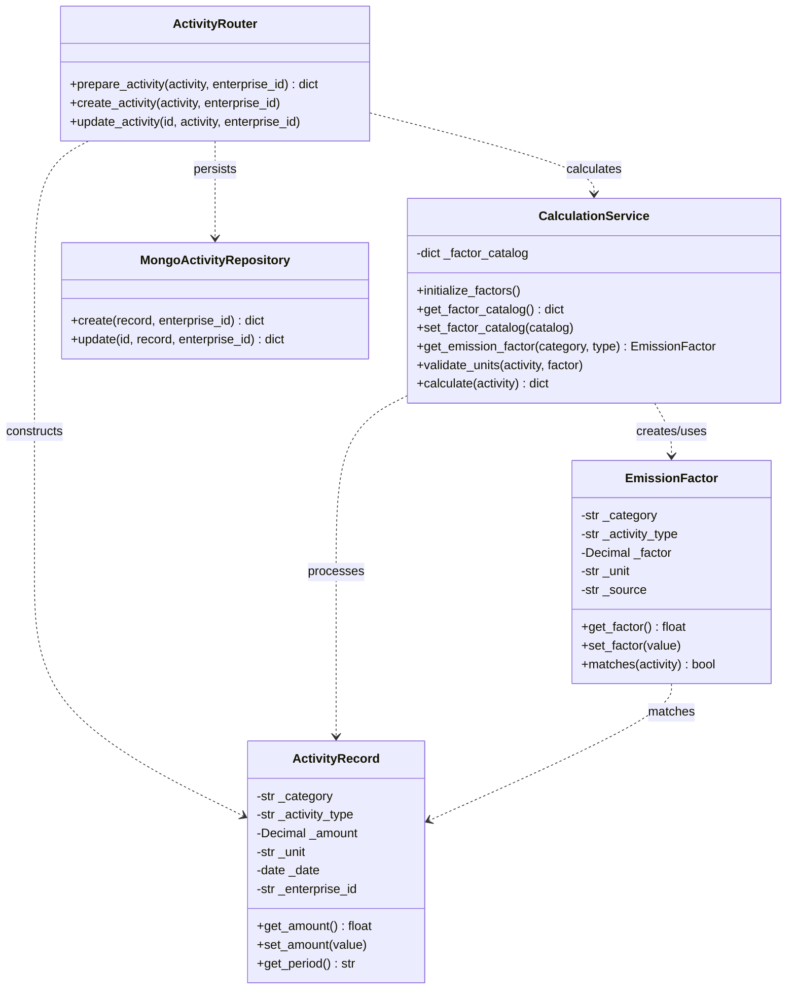

# Hometask 1 — Subsystem 2: Object-Oriented Concepts

**Author:** Oscar Daniel de la Cruz Jara  
**Assigned subsystem:** Carbon Activity Management & Calculation Engine

## Three implemented classes

| Class | Responsibility | Constructor | Encapsulation / setup |
|---|---|---|---|
| `ActivityRecord` | Models an enterprise carbon activity with category, type, amount, unit, date, and enterprise | `__init__(...)` | Getters/setters validate state; `get_period()` derives reporting month |
| `EmissionFactor` | Represents a configured emission multiplier and metadata | `__init__(...)` | Getters/setters and `matches(activity)` |
| `CalculationService` | Loads catalog, selects factor, validates units and calculates CO2e | `__init__(factor_catalog=None)` | `initialize_factors()`, catalog getter/setter, `calculate()` |

The OOP implementation lives in `backend/app/activities/oop.py`. The FastAPI activity create/update flow now instantiates `ActivityRecord` and runs `CalculationService.calculate()`; the service selects an `EmissionFactor`. The existing JSON request/response fields and MongoDB repository interface are preserved. React uses these classes through the existing HTTP endpoints; Python classes are not executed in the browser.

## UML class diagram



Each model also exposes getters/setters for its other private attributes; see source for the full implementation.

## Run the tests

From `backend/`:

```bash
python -m pip install -r requirements-dev.txt
python -m pytest tests/test_oop_hometask1.py -v
```

## Suggested personal demonstration (~45–60 seconds)

1. Explain how `ActivityRecord` encapsulates activity inputs and rejects nonpositive amounts.
2. Show `EmissionFactor.matches()` preventing invalid category/type/unit combinations.
3. Explain how `CalculationService` loads the existing JSON factors and computes a two-decimal result.
4. Demonstrate `python -m pytest tests/test_oop_hometask1.py -v` and connect the class relationships to this Mermaid UML.

## Team video

Add the final **single 3–5 minute team presentation link** to the root README once the recording is uploaded.

## Production flow

`React activity form → POST/PUT /activities/ → ActivityCreate (Pydantic) → ActivityRecord → CalculationService → EmissionFactor → MongoActivityRepository → JSON response to React`.

The calculation result includes `co2e_kg`, `emission_factor`, `factor_source`, `factor_source_url`, `factor_year`, `factor_region`, `factor_methodology`, `treatment_method`, and `period` to preserve the previously persisted fields.

### Verification checklist

- Run `python -m pytest tests/ -v` in `backend/`.
- Test creating and updating an activity from React, then check its history and MongoDB entry.
- Verify electricity, heating, transport and waste values against `emission_factors.json`.
- Keep the PR unmerged until the entire team has reviewed and tested it.
